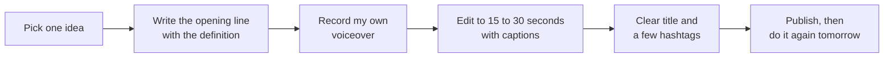
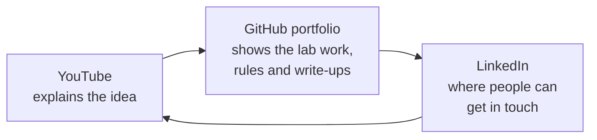

## Welcome to Granger Security

Hi, I'm Bhargav. Granger Security is my YouTube channel, where I explain cyber security ideas in plain English and share what I'm learning as I work towards my first security role.

I'm not a big course creator with a studio. I record short videos about the things I'm studying and building in my own lab, and I keep the mistakes in, because that's usually where the real learning happens.

The channel is for:

* people trying to get into a security operations role
* anyone studying for Security+ who wants a concept explained quickly
* career changers who want to see that the move is possible
* anyone building a home lab on an Apple Silicon Mac, where many tools don't run straight away

I've published more than 230 videos and Shorts since 2022.

## What I'm making right now

At the moment I'm posting a daily series of short explainers in the **[Learn AI Security](https://youtube.com/playlist?list=PLgzSoK4Xo5hnXGebggfe9BUYkywfqWrnW)** playlist. Each one takes a single idea, like SIEM, phishing, ransomware, log analysis, CVEs or zero-days, and explains it in 15 to 30 seconds.

Every Short goes through the same steps:

I keep it to one idea per video so it's easy to follow, and I post daily because a steady rhythm works better for me than the occasional big video.

## Earlier CVE breakdowns

Back in February 2026 I made a short run of longer videos, each looking at one serious vulnerability that attackers were exploiting at the time. That series is paused while I focus on the daily Shorts.

| CVE | What it was | Severity |
|---|---|---|
| CVE-2026-20127 | Cisco Catalyst SD-WAN authentication bypass, exploited as a zero-day and added to CISA's Known Exploited Vulnerabilities list | Critical |
| CVE-2020-7796 | Zimbra server-side request forgery, still being exploited in 2026 | Critical, CVSS 9.8 |
| CVE-2026-2441 | Chrome use-after-free in its CSS component, exploited in the wild | High, CVSS 8.8 |

You'll find them on the [channel](https://youtube.com/@Granger-Security).

## How it all fits together

My videos, my GitHub and my LinkedIn each do a different job, and they point to each other.

When a video covers one of my labs, it links to the full write-up in my [security portfolio](https://github.com/Granger0007/Bhargav-Baranda-Portfolio), where you'll find the detection rules and the MITRE ATT&CK mapping.

## About me

I'm **Bhargav Baranda**. I hold an MSc in Information Security from Royal Holloway, University of London, which is an NCSC-recognised Academic Centre of Excellence in Cyber Security Research. I passed CompTIA Security+ (SY0-701) in August 2026.

My home lab runs on an Apple Silicon Mac with UTM and Kali Linux, alongside Splunk, Suricata and a Wazuh SIEM on a cloud server. I've written up thirteen labs on GitHub, covering network analysis, threat detection, phishing investigations and vulnerability management. I also built [OZONE Shield](https://ozone-shield.bbaranda055.workers.dev), a free tool that helps people check whether a message is a scam.

I first started the channel in 2022, took a break, and picked it up again in 2026 while studying for Security+ and looking for my first security role. The daily Shorts are how I learn, and I share them as I go.

## Get in touch

| Where | Link |
|---|---|
| YouTube | [@Granger-Security](https://youtube.com/@Granger-Security) |
| Learn AI Security playlist | [Watch the series](https://youtube.com/playlist?list=PLgzSoK4Xo5hnXGebggfe9BUYkywfqWrnW) |
| LinkedIn | [linkedin.com/in/bhargav-baranda](https://www.linkedin.com/in/bhargav-baranda) |
| GitHub | [github.com/Granger0007](https://github.com/Granger0007) |
| OZONE Shield | [ozone-shield.bbaranda055.workers.dev](https://ozone-shield.bbaranda055.workers.dev) |

*Thanks for stopping by. If a video helps you, I'd love to hear about it.*

